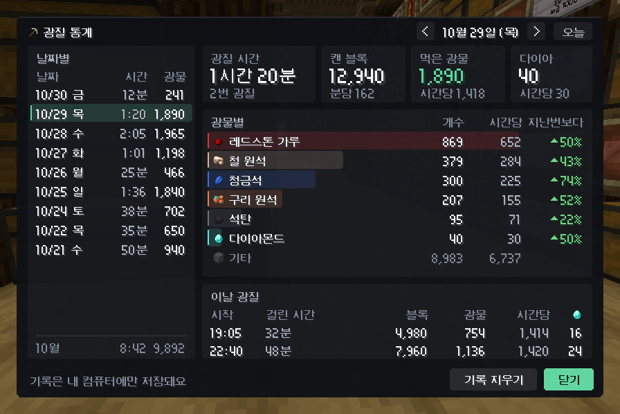

# 픽트래커 (PickTracker)

만든 사람: **한서**

마인크래프트 **1.21.4 Fabric** 클라이언트 모드예요. 광질하면서 **어떤 블록을 몇 개 캤는지**, **광물을 몇 개 먹었는지**를 세서 화면에 보여줘요.
야생에서 곡괭이로 광질을 시작하면 **알아서 기록을 시작**하고, 한동안 안 캐면 **알아서 끝내요.**
끝난 광질은 **광질 통계**에 쌓여서, 오늘 · 7일 · 30일 · 전체를 막대그래프로 볼 수 있어요. 집계판 모양 4가지, 테마 6가지 중에서 골라 쓸 수 있어요.

> 위 이미지는 모드의 그리기 코드를 그대로 돌려서 만든 예시예요. 글자는 게임에서 쓰는 글꼴로 나와요.

## 기능

- **자동 기록:** 야생에서 곡괭이로 돌이나 광석을 캐면 기록이 시작돼요. 정해 둔 시간(기본 1분) 동안 안 캐면 광질이 끝난 걸로 보고 기록을 끝내요.
- **집계판:** 기록 중일 때만 떠요. 광질 시간은 크게, 먹은 광물은 아이템 색깔 막대와 함께 보여줘요.
- **먹은 광물은 확실한 것만:** 아이템 저장소가 핫바 위에 띄우는 "[아이템 저장소] 다이아몬드 1개 수납!" 알림과, 인벤토리로 바로 들어오는 서버 광물(토파즈 등)로 세요. 바닥에서 사라진 아이템을 보고 짐작하지 않아서 저장소에 들어간 개수와 맞게 세요.
- **집계판 모양 4가지:** 자세히(캔 블록은 종류별로, 광물은 개수와 막대로) / 슬림(기본값, 캔 블록·먹은 광물 합계와 광물별 개수) / 아이콘(광물을 색깔 칸에) / 한 줄(화면 위 가운데).
- **테마 6가지:** 민트(기본) / 파랑 / 보라 / 주황 / 흰색 / 투명. 집계판, 획득 알림, 설정창, 광질 통계 색이 같이 바뀌어요.
- **측정 중 / 쉬는 중:** 자동 기록 중에 10초 넘게 안 캐면 "쉬는 중"(회색)으로 바뀌고, 그동안은 시간이 멈춰요.
- **먹은 광물을 블록으로 (B):** B를 누르면 집계판의 먹은 광물이 블록 개수로 바뀌어요. 9개가 블록 1개라서 레드스톤 가루 1,191개는 "레드스톤 블록 132 +3"(블록 132개, 가루 3개 남음)으로 나와요. 레드스톤 · 청금석 · 철/구리/금 원석 · 다이아몬드 · 에메랄드 · 석탄 · 철/금/구리 주괴가 바뀌고, 토파즈 같은 서버 광물과 기타는 그대로예요. 맨 위에 "픽트래커 · 블록으로"가 떠요. 한 번 더 누르면 개수로 돌아오고, 고른 보기는 저장돼요. 막대 길이와 순서, 먹은 광물 합계, 획득 알림은 원래 개수 그대로예요.
- **획득 알림:** 광물을 먹으면 화면 오른쪽에 "철 원석 +8"처럼 한 줄로 떠요. 같은 아이템을 연달아 먹으면 숫자가 합쳐져요.
- **광질 통계 (F10):** 끝난 광질을 오늘 · 7일 · 30일 · 전체로 모아 보여줘요. 날짜별 막대그래프와 광물별 개수 · 비율이 나오고, 막대를 누르면 그날만 자세히 볼 수 있어요. **복사**를 누르면 통계 창이 그림으로 복사돼서 디스코드에 Ctrl+V로 바로 보낼 수 있어요.
- **채팅 기록:** 광질이 끝나면 이번 기록을 채팅에 남겨요. 나한테만 보여요.
- **3x3 채광 지원:** 한 번에 깨진 주변 블록도 같이 세요.
- **서버가 되돌린 블록 제외:** 보호 구역처럼 서버가 블록을 다시 되돌리면 그 블록은 빼요. 되돌렸다가 서버가 바로 다시 깨면 다시 세요.
- **기타 아이템:** 조약돌, 심층암 조약돌, 흙 같은 아이템은 "기타 N종" 한 줄로 합치고 알림은 띄우지 않아요.

## 어디서 기록하나요?

띵타이쿤은 화면 오른쪽 위 막대에 `2026.10.31 03:19 무성한 동굴 〈야생5〉`처럼 지금 채널이 나와요. 모드가 이 글자를 읽어서 **〈야생○〉 채널에서만** 자동으로 기록하고 먹은 광물을 세요(읽기만 하고 서버로는 아무것도 안 보내요).

- **야생:** 자동으로 기록해요.
- **마을 · 스폰 · 아일랜드(세레니티 등):** 채널 이름이 야생이 아니라서 자동으로 빠져요. 기록 중에 야생을 벗어나면 그때부터는 안 세고, 1분 뒤 기록이 끝나 통계에 저장돼요.
- **채널을 옮길 때:** 〈야생1〉 → 〈야생3〉처럼 채널이 바뀌면 3초 동안 인벤토리로 들어오는 건 안 세요(서버가 인벤토리를 다시 채우는 걸 먹은 걸로 세지 않게).
- **채널 이름이 안 보이는 서버:** 월드 이름으로 판단해요(오버월드·네더가 야생).

어디서든 직접 기록하고 싶으면 F7(또는 `/광질 시작`)을 누르면 돼요.

## 광질 통계 (F10 또는 `/광질 통계`)

- **위쪽 탭:** 오늘 · 7일 · 30일 · 전체. 처음 열면 오늘이 나와요. 위쪽 가운데 **홈**을 누르면 어디에 있든 처음 화면(오늘)으로 돌아가요.
- **네 칸:** 광질 시간, 캔 블록, 먹은 광물, 광질 횟수(몇 번 했는지).
- **막대그래프:** 날짜별로 먹은 광물이에요. 오늘 막대만 진하게 나와요. 7일은 막대 위에 숫자가 나오고, 30일은 막대에 마우스를 올리면 그날 숫자가 떠요. 전체는 한 달에 막대 하나이고, 누르면 그달의 날짜별 막대로 바뀌어요(왼쪽 위 **<** 로 돌아가요).
- **막대를 누르면 그날만:** 그날의 네 칸, 광물별, **이날 광질**(시작 시각, 걸린 시간, 캔 블록, 먹은 광물)이 나와요. 위쪽 < >나 키보드 ← →로 하루씩 옮기고, **돌아가기**를 누르면 원래 화면으로 가요. **오늘** 탭도 같은 모양으로 오늘을 보여줘요.
- **이날 광질에서 광질 하나만:** 이날 광질의 줄(시작 시각 · 블록 수 등 어디든)을 누르면 그 줄이 초록색으로 표시되고, 광물별 표에 **그 광질에서 먹은 광물만** 나와요(위쪽에 "13:13 광질"처럼 어느 광질인지 붙어요). 같은 줄을 한 번 더 누르거나 **하루 전체**를 누르면 하루 합계로 돌아가요. 위쪽 네 칸은 하루 합계 그대로예요. 광질마다 먹은 광물이 따로 저장돼 있어서 예전 기록도 볼 수 있고, 이 상태로 **복사**하면 그 광질의 광물별이 그림으로 들어가요.
- **광물별:** 먹은 광물의 개수와 비율(먹은 광물 중 몇 %인지)이에요.
- **광물 고르기:** 광물별 옆 **고르기**를 누르면 지금까지 먹어 본 광물이 스위치와 함께 나와요. 켠 광물은 전부 표에 나오고(광물이 많으면 통계 창이 그만큼 길어져요), 끈 광물은 맨 아래 **그 외 N종** 한 줄로 합쳐져서 합계와 비율은 그대로 맞아요. 고른 뒤에 처음 먹는 광물도 그 외로 들어가니, 보고 싶으면 켜 주세요. **전부 켜기**를 누르면 처음처럼 전부 나와요. 표와 복사한 그림에만 적용되고, 먹은 광물 합계 · 막대그래프 · 집계판 · 획득 알림은 그대로예요. 고른 건 설정 파일에 저장돼요.
- **복사:** 위쪽 탭 왼쪽의 **복사**를 누르면 지금 보고 있는 통계 창이 그림으로 클립보드에 들어가요. 디스코드 같은 채팅창에서 Ctrl+V를 누르면 바로 이미지로 올라가요. 아래 버튼 줄과 화살표는 빠지고, 모니터 · GUI 크기와 상관없이 늘 같은 크기(가로 848픽셀)예요. 클립보드에 넣을 수 없는 환경(맥 등)에서는 `screenshots` 폴더에 `mining-stats_날짜.png`로 저장하고 채팅에 알려줘요. 내 컴퓨터의 클립보드만 쓰고 서버로는 아무것도 보내지 않아요.
- **언제 저장되나요?** 광질이 끝날 때(자동으로 끝나거나 F7), 서버에서 나갈 때, 게임을 끌 때 저장돼요. 지금 하고 있는 광질은 끝나야 통계에 들어가요(그동안은 집계판을 보면 돼요). F8로 집계판을 초기화해도 그때까지 캔 건 통계에 남아요.
- **어디에 저장되나요?** `.minecraft/config/mining-tracker-history.json`에, 내 컴퓨터에만 저장돼요. 서버로는 아무것도 보내지 않아요.
- **방금 기록 취소:** 마지막으로 저장된 광질 하나를 지워요. 한 번 누르면 어떤 기록인지 왼쪽 아래에 나오고, 3초 안에 한 번 더 누르면 지워져요.
- **전체 기록 지우기:** 3초 안에 두 번 누르면 저장된 기록이 모두 지워져요.

## 설정창 (F9 또는 `/광질 설정`)

| 설정 | 선택 | 기본 |
| --- | --- | --- |
| 기록 방식 | 자동 / 수동 | 자동 |
| 광질 끝 판정 | 30초 / 1분 / 3분 / 5분 | 1분 |
| 다시 시작하면 | 0부터 / 이어서 | 0부터 |
| 끝나면 채팅에 기록 | 켜기 / 끄기 스위치 | 켜기 |
| 집계판 모양 | 자세히 / 슬림 / 아이콘 / 한 줄 | 슬림 |
| 먹은 광물 | 개수 / 블록으로 (B 키와 같아요) | 개수 |
| 테마 | 민트 / 파랑 / 보라 / 주황 / 흰색 / 투명 | 민트 |
| 광질 통계 | 열기 (F10과 같아요) | |

- **수동**으로 바꾸면 자동으로 시작하지 않고, F7로 시작하고 F7로 끝내요.
- 누르는 순간 바로 저장돼요. **위치/크기 편집**을 누르면 집계판과 알림을 옮기고 크기를 바꿀 수 있어요. 안쪽을 끌면 옮겨지고, **테두리나 모서리를 꾹 눌러 끌면 크기가 바뀌어요**(반대쪽은 그 자리에 있어요). 모서리의 작은 네모가 잡는 곳이에요. 마우스 휠로도 크기를 바꿀 수 있어요. 크기는 끌어도 휠로 바꿔도 **5% 단위**(45% ~ 300%)로 바뀌어요. "한 줄" 모양은 위치를 따로 기억해요.
- 집계판 숫자는 게임을 켜 둔 동안만 남아요("이어서"도 마찬가지예요). 끝난 광질은 광질 통계에 저장돼서 게임을 꺼도 남아요.
- 0.2.x에서 쓰던 테마는 비슷한 새 테마로 바뀌어요(기본·검정 → 민트, 바닐라 → 보라, 인벤토리 → 흰색).

## 설치

1. [Fabric Loader](https://fabricmc.net/use/)와 [Fabric API](https://modrinth.com/mod/fabric-api)(1.21.4용)가 필요해요.
2. `picktracker-x.y.z.jar` 파일을 `.minecraft/mods` 폴더에 넣으면 돼요. 예전 버전 jar는 지워 주세요.

> 서버에서 쓰려면 먼저 서버 규칙(허용 모드)을 확인하고, 필요하면 운영진 허가를 받으세요. 이 모드는 화면에 보이는 정보만 세고 게임 동작은 전혀 바꾸지 않아요. 서버로 보내는 것도 없어요.

## 단축키

| 키 | 기능 |
| --- | --- |
| F6 | 집계판 보이기/숨기기 |
| F7 | 기록 직접 시작/끝내기 |
| F8 | 3초 안에 두 번 누르면 집계판 초기화 (통계에는 남아요) |
| F9 | 설정창 열기 (한 번 더 누르면 닫혀요) |
| F10 | 광질 통계 열기 (한 번 더 누르면 닫혀요) |
| B | 먹은 광물을 블록으로 보기 / 개수로 보기 |

키는 `설정 → 조작 → 키 설정 → 픽트래커`에서 바꿀 수 있어요.

## 명령어

| 명령어 | 기능 |
| --- | --- |
| `/광질` | 도움말 |
| `/광질 설정` | 설정창 열기 |
| `/광질 통계` | 광질 통계 열기 |
| `/광질 시작`, `/광질 종료` | 기록 직접 시작/끝내기 |
| `/광질 초기화` | 집계판 숫자 초기화 (그때까지 캔 건 통계에 남아요) |
| `/광질 숨기기`, `/광질 보이기` | 집계판 숨기기/보이기 |
| `/광질 알림 켜기`, `/광질 알림 끄기` | 획득 알림 켜기/끄기 |
| `/광질 블록 켜기`, `/광질 블록 끄기` | 먹은 광물을 블록으로 보기/개수로 보기 (B와 같아요) |
| `/광질 편집` | 위치·크기 편집 화면 바로 열기 |
| `/광질 진단` | 숫자가 이상하거나 자동 기록이 안 켜질 때 확인용 (지금 채널, 야생으로 잡히는지, 저장소 알림 · 인벤토리로 각각 몇 개를 셌는지, 같은 알림이라 뺀 것을 보여줘요) |
| `/광질 진단 최근` | 최근 판정 20개: 무엇을 왜 셌는지, 왜 안 셌는지 (예: `다이아몬드 +1 · 저장소 알림 (저장소 271개)`, `다이아몬드 1개 · 안 셈: 같은 알림이 또 옴`) |

명령어는 내 컴퓨터에서만 처리되고 서버로 보내지 않아요.

## 설정 파일

`.minecraft/config/mining-tracker.json`에 저장돼요. 설정창에 없는 항목도 직접 고칠 수 있어요.

- `layout`, `theme`: 집계판 모양과 테마 (설정창에서 바꾸는 게 편해요). 테마 이름은 `mint`, `blue`, `purple`, `orange`, `white`, `clear`예요.
- `maxBlockRows`, `maxItemRows`: 집계판에 보여줄 줄 수 (기본 5, 8)
- `toastOthers`: 조약돌 같은 기타 아이템도 알림 띄우기 (기본 `false`)
- `otherItems`: "기타"로 묶을 아이템 ID 목록
- `wildDimensions`: 채널 이름이 안 보일 때 야생으로 볼 월드 이름 (기본 `minecraft:overworld`, `minecraft:the_nether`)
- `endAfterSeconds`: 광질 끝 판정 시간(초). 설정창에 없는 시간(예: 120)도 쓸 수 있어요.
- `statsKinds`: 광질 통계 광물별 표에 보일 광물 (`아이템 ID|이름` 목록, 통계의 **고르기**에서 바꾸는 게 편해요). 없으면 전부 보여요.
- `countInventory`: 인벤토리로 바로 들어오는 것도 세기 (기본 `true`)
- `mineralBlocks`: 먹은 광물을 블록으로 보기 (기본 `false`, B로 바꾸는 게 편해요)

광질 통계 기록은 `.minecraft/config/mining-tracker-history.json`에 따로 저장돼요. 이 파일이 망가져서 읽을 수 없으면 `mining-tracker-history.json.broken`으로 따로 남겨 두고 새로 시작해요.

## 어떻게 세나요?

- **블록:** 내가 캔 블록은 바로 세요. 그 블록 바로 옆의 단단한 블록이 곧바로 사라지면 같이 캔 것으로 세요(3x3 스킬). 서버가 블록을 되돌리면 그만큼 빼요. 되돌린 블록이 내가 다시 캐지 않았는데 1.5초 안에 사라지면(서버가 직접 다시 깬 경우) 다시 세요.
- **먹은 아이템 (저장소 알림):** 아이템을 먹으면 아이템 저장소가 핫바 위에 `[아이템 저장소] 다이아몬드 1개 수납! (270/30,000)`처럼 띄워요. 이 글자를 읽어서 이름과 개수(1개)만큼 세요. 괄호 안 270은 저장소에 든 그 광물 개수라서, 같은 숫자로 알림이 또 오면 같은 알림으로 보고 안 세요. 괄호 숫자가 알림보다 더 늘었으면(예: 270 → 275인데 알림은 1개) 그 사이 알림을 놓친 거예요. 아래가 다 맞을 때만 차이를 채워서 세요: 그 사이 계속 기록 중이었고, 야생을 벗어나거나 채널을 옮기지 않았고, 어떤 창(저장소 · 상자 · 채팅)도 안 열었고(직접 넣으려면 창을 열어야 하니까), 인출이 없었고, 두 알림이 2분 안에 왔을 때예요. 그 사이 인벤토리로 들어와서 이미 센 같은 아이템은 빼고 채워요. 조건이 안 맞으면 채우지 않고 `/광질 진단`에 따로 보여줘요.
- **알림을 못 읽을 때 대비:** 알림은 핫바 위에 글자가 올라가는 순간 읽어요. 혹시 다른 모드 때문에 그 순간을 놓치면, 지금 화면에 떠 있는 글자를 직접 읽어서 세요(같은 알림을 두 번 세지는 않아요). 이렇게 읽은 건 `/광질 진단`에 "화면 글자로 읽은 것"으로 나와요.
- **먹은 아이템 (인벤토리):** 토파즈 같은 서버 광물은 바닥에 안 떨어지고 인벤토리로 바로 들어와요. 인벤토리의 아이템 개수가 늘어나면 1.5초 기다렸다가 세요. 그사이 같은 아이템의 저장소 알림이 오면 그건 저장소 쪽으로 이미 센 거라 또 세지 않아요. 그래서 인벤토리로 들어온 건 알림이 1.5초쯤 늦게 떠요.
- **인벤토리에서 안 세는 것:** 창(인벤토리 · 상자 · 상점 · 채팅)이 열려 있을 때와 닫고 1초 동안 들어온 것, 접속 · 리스폰 · 채널 이동 직후 인벤토리가 다시 채워지는 것, `N개 인출` 알림 바로 뒤에 들어온 것(저장소에서 꺼낸 것), 같은 순간 다른 아이템이 줄어든 것(아이템이 다른 걸로 바뀐 것), 줄었다가 1초 안에 원래 개수로 돌아온 것(서버가 설치나 버리기를 되돌린 것). 이름만 바뀐 도구(캔 개수가 이름에 나오는 곡괭이 등)는 늘거나 준 걸로 보지 않아요.
- **왜 셌는지 보기:** `/광질 진단 최근`을 치면 최근 판정 20개가 이유와 함께 나와요. 숫자가 저장소와 다르면 이걸 보면 어디서 달라졌는지 알 수 있어요.
- **바닥 아이템은 안 봐요:** 바닥에 떨어진 아이템을 1초에 20번 훑던 예전 방식은 0.5.1에서 없앴어요(바닥에 아이템이 많을 때 가장 무거운 부분이었어요). 먹은 건 저장소 알림과 인벤토리로만 세요. 저장소 알림에 서버 아이템 이름이 나오면, 그 아이템이 내 근처에서 사라지는 순간 본 모양으로 아이콘을 맞춰요.
- **다른 사람과 같이 캘 때:** 저장소 알림은 내가 먹은 것만 떠서, 옆에서 다른 사람이 캐도 섞이지 않아요.
- **곡괭이 판단:** 바닐라 곡괭이이거나, 이름에 "곡괭이"가 들어간 아이템이면 곡괭이로 봐요.

## 깃허브에서 빌드하기

이 저장소에는 깃허브가 자동으로 모드를 빌드하는 설정(`.github/workflows/build.yml`)이 들어 있어요.

1. 깃허브에 파일을 올리면 위쪽 **Actions** 탭에서 `build`가 자동으로 실행돼요.
2. 초록색 체크가 뜨면 그 실행을 누르고, 아래쪽 **Artifacts**에서 `picktracker`를 내려받으세요.
3. 압축을 풀면 파일이 두 개 있어요.
   - `picktracker-x.y.z.jar`: 모드 파일이에요. 이것만 `mods` 폴더에 넣으세요.
   - `picktracker-x.y.z-sources.jar`: 소스 코드예요. 운영진에게 소스 코드를 보여줄 때 쓰고, `mods` 폴더에는 넣지 마세요.

버전은 `gradle.properties`의 `version=`에서 바꿔요. 작은 수정은 맨 오른쪽 숫자를, 큰 변경은 가운데나 왼쪽 숫자를 올려요.

직접 빌드하려면 깃허브 빌드와 같은 Java 25를 설치하고 `./gradlew build`를 실행하면 `build/libs/`에 jar가 생겨요.

## 버전 기록

- **0.1.0:** 첫 버전.
- **0.1.1:** 소스 코드 jar(`-sources.jar`)도 같이 만들기.
- **0.1.2:** 자동 기록(야생에서 광질하면 시작, 1분 안 캐면 끝), 설정창(F9), 끝나면 채팅에 기록, 먹은 광물은 '획득' 한 칸으로.
- **0.1.3:** 먹은 광물을 빠뜨리던 경우를 고쳤어요. 1~2칸 옆에 몇 초 놓여 있다가 주운 아이템, 뛰어가면서 주운 아이템, 막 떨어져서 바로 주운 아이템, 주운 직후 순간이동한 경우를 이제 세요. 합쳐진 아이템을 두 번 세던 경우도 막았어요.
- **0.2.0:** 집계판 모양 4가지(자세히·슬림·아이콘·한 줄)와 테마 5가지(기본·바닐라·인벤토리·검정·투명)를 설정창에서 고를 수 있어요. 슬림과 아이콘 모양에는 분당·시간당 효율도 나와요.
- **0.2.1:** 먹은 광물을 세는 방법을 고쳤어요. 아이템끼리 합쳐질 때 근처에서 늘어난 개수만큼만 빼서, 몰려 있는 아이템(3x3 스킬, 빠르게 달리며 광질)을 먹을 때 숫자가 빠지던 걸 막았어요. 합쳐지는 거리가 먼 서버에서도 맞게 세요. 서버가 되돌렸다가 바로 다시 깬 블록을 다시 세요. `/광질 진단`에 "합쳐질 때 거리"를 추가했어요.
- **0.3.0:** 화면을 새 디자인(모던 카드)으로 바꿨어요. 집계판·획득 알림·설정창·위치 편집 화면이 모두 새 모양이고, 테마는 6가지(민트·파랑·보라·주황·흰색·투명)예요. 획득 알림에 지금까지 먹은 개수(총 N개)가 나와요. **광질 통계**(F10, `/광질 통계`, 설정창의 "광질 통계")를 추가했어요. 끝난 광질이 날짜별로 내 컴퓨터에 저장되고, 그날 합계, 광물별 개수와 시간당, 지난번과 비교, 그날 광질 목록을 볼 수 있어요. 서버에서 나가면 기록이 끝나고 통계에 저장돼요.
- **0.3.1:** 자석펫(5칸)을 쓰면서 빠르게 광질할 때 먹은 광물이 적게 세지던 걸 고쳤어요. 이제 5칸 안에서 사라진 아이템도 세요. 합쳐진 아이템을 더 정확히 맞춰서, 서버의 합쳐지는 거리가 멀 때도 맞게 세요. 다른 사람이 근처에서 3x3로 캘 때 그 사람이 한꺼번에 주운 걸 바닥 청소로 잘못 보고 내 것까지 빼던 것도 고쳤어요. `/광질 진단`에 자석 범위에서 센 개수를 추가했어요.
- **0.3.2:** 획득 알림을 예전처럼 작은 한 줄(아이콘 · 이름 · 초록색 +N)로 되돌렸어요. 색은 지금 테마를 따라가요.
- **0.4.0:** **광질 통계**를 세공 통계처럼 바꿨어요. 오늘 · 7일 · 30일 · 전체 탭, 날짜별(전체는 달별) 막대그래프, 광물별 개수와 비율이 나오고, 막대를 누르면 그날만 자세히 볼 수 있어요. **방금 기록 취소** 버튼을 추가했어요. 시간당 · 분당 숫자는 집계판과 통계에서 모두 뺐어요(시간당으로 지난번과 비교하던 칸도 같이 빠졌어요). 통계의 다이아 칸은 광질 횟수로 바꿨어요.
- **0.4.1:** 광질 통계에 **복사** 버튼을 추가했어요. 통계 창만 그림으로 클립보드에 넣어서, 디스코드 채팅에서 Ctrl+V로 바로 보낼 수 있어요. 모니터 · GUI 크기와 상관없이 같은 크기로 나오고, 클립보드에 넣을 수 없으면 screenshots 폴더에 저장해요.
- **0.4.2:** **복사**로 붙여넣으면 검은 그림만 나오던 걸 고쳤어요(그림을 그리는 동안 게임 화면 대신 그림 쪽에 그리게 했어요). 비어 있는 그림은 복사하지 않고 알려줘요. 광질 통계 위쪽 가운데에 **홈** 버튼을 추가했어요. 누르면 처음 열었을 때 화면(7일)으로 바로 가요.
- **0.4.3:** 광질 통계 광물별 표에 **고르기**를 추가했어요. 보고 싶은 광물만 켜 두면 표(와 복사한 그림)에 그것만 나오고, 나머지는 그 외 한 줄로 합쳐져요. 9가지가 넘어서 안 보이던 광물도 이제 그 외에 더해져요.
- **0.4.4:** 광물별 표에 켠 광물이 8가지에서 끊기지 않고 전부 나와요(복사한 그림도). 서버 아이템(토파즈 · 사파이어 · 플래티넘 등)이 통계에서 종이 모양으로 나오던 걸 고쳤어요. 먹을 때 서버 아이템의 그림 정보도 기록해서 그 모양으로 그려요. 예전 기록은 그 광물을 한 번 더 먹거나 인벤토리에 가진 채로 통계를 열면 바뀌어요. 서버 광물의 막대 색을 이름에 맞췄고(토파즈 주황, 사파이어 파랑, 플래티넘 은색), 아주 작은 비율은 <0.1%로 보여요.
- **0.5.0:** 먹은 광물을 아이템 저장소 알림(`[아이템 저장소] ○○ N개 수납!`)으로 세요. 바닥에서 사라진 아이템을 보고 짐작하던 방식은 기본으로 꺼서, 합쳐지거나 청소된 아이템까지 세서 저장소보다 많이 나오던 걸 고쳤어요. 토파즈처럼 인벤토리로 바로 들어오는 서버 광물도 세요. `/광질 진단`에 저장소 알림 · 인벤토리로 센 개수를 따로 보여주고, `/광질 진단 최근`으로 무엇을 왜 셌는지 볼 수 있어요. 광질 통계는 처음 열면 오늘이 나오고, 홈도 오늘로 가요. 위치/크기 편집에서 집계판과 알림의 테두리나 모서리를 끌어서 크기를 바꿀 수 있어요.
- **0.5.1:** 화면 오른쪽 위의 채널 이름(〈야생5〉 · 〈마을14〉 · 〈아일랜드4〉)을 읽어서 야생 채널에서만 기록하고 세요. 채널을 옮기면 3초 동안 인벤토리로 들어오는 건 안 세요. 바닥 아이템을 계속 훑던 부분(예전 짐작 방식)을 없애서 가벼워졌어요. `/광질 진단`에 지금 채널이 나와요.
- **0.5.2:** `/광질 끝`을 `/광질 종료`로 바꿨어요(예전 이름도 그대로 돼요). 위치/크기 편집에서 크기가 5% 단위로 바뀌어요. 설정의 "지금 있는 곳에서 자동 기록" 스위치를 없애고, 자동 기록은 무조건 야생에서만 해요.
- **0.5.3:** 저장소 알림을 놓쳤을 때 괄호 숫자로 채워서 세요(계속 기록 중 · 야생 · 창 안 열었음 · 인출 없음 · 2분 안일 때만). 알림을 읽는 순간을 놓쳐도 화면에 떠 있는 글자로 한 번 더 읽어요. `/광질 진단`에 채운 개수와 화면 글자로 읽은 개수가 나와요.
- **0.5.4:** 모드 이름을 **픽트래커 (PickTracker)**로 바꾸고 만든 사람(한서)을 넣었어요. 채팅 · 설정창 · 집계판 · 키 설정에 보이는 이름도 픽트래커로 바뀌었어요. jar 파일 이름은 `picktracker-x.y.z.jar`예요. 설정과 통계 기록 파일은 그대로라 지금까지 쌓인 기록이 이어져요.
- **0.5.5:** 광질 통계의 이날 광질에서 광질 하나를 누르면, 광물별 표에 그 광질에서 먹은 광물만 나와요(위쪽에 "13:13 광질"처럼 어느 광질인지 붙어요). 같은 줄을 한 번 더 누르거나 **하루 전체**를 누르면 하루 합계로 돌아가요. 예전 기록도 볼 수 있어요.
- **0.5.6:** **B**를 누르면 집계판의 먹은 광물이 블록 개수로 바뀌어요(9개 = 블록 1개, 남는 건 +N). 설정창의 "먹은 광물"(개수 / 블록으로)과 `/광질 블록 켜기` · `/광질 블록 끄기`로도 바꿀 수 있고, 고른 보기는 저장돼요. 서버 광물과 기타는 그대로예요.
