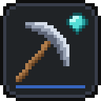
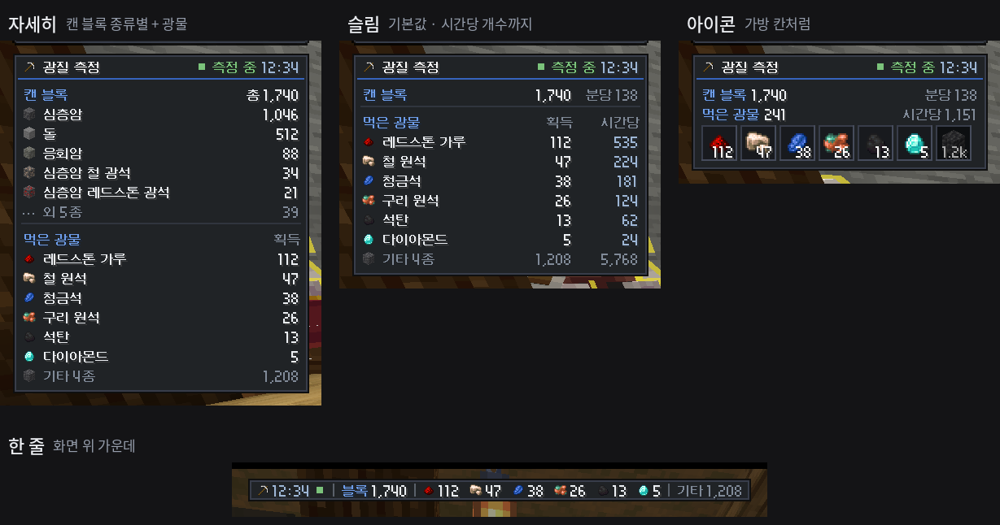
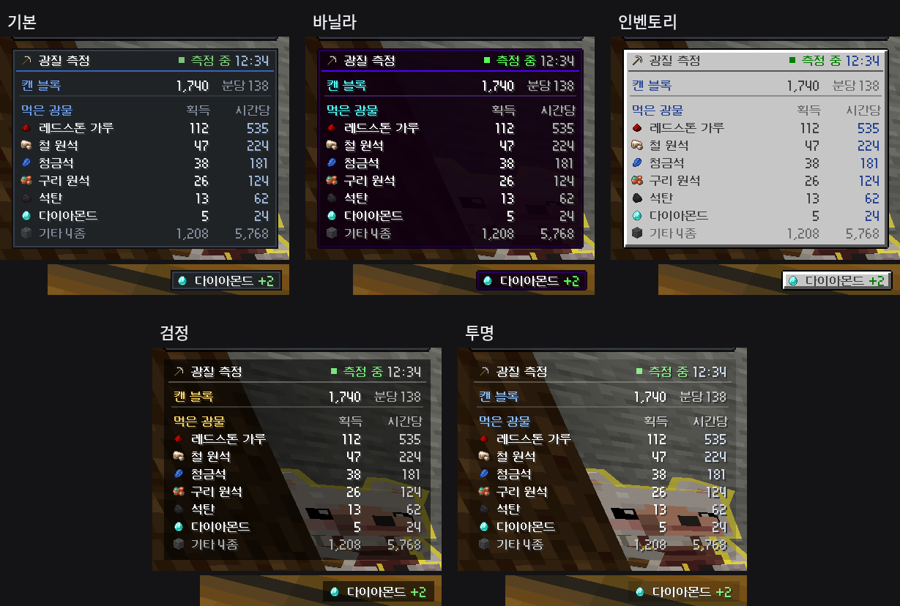
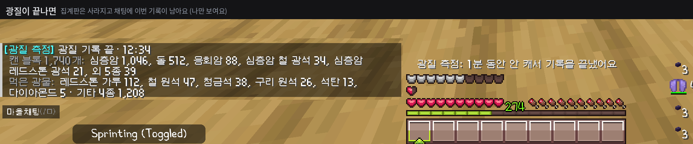
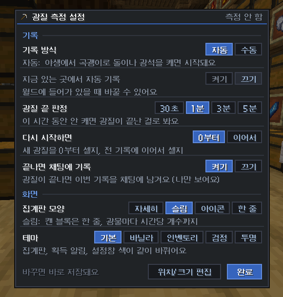

# 광질 측정 (Mining Tracker)

마인크래프트 **1.21.4 Fabric** 클라이언트 모드예요. 광질하면서 **어떤 블록을 몇 개 캤는지**, **광물을 몇 개 먹었는지**를 세서 화면에 보여줘요.
야생에서 곡괭이로 광질을 시작하면 **알아서 기록을 시작**하고, 한동안 안 캐면 **알아서 끝내요.**
집계판 모양 4가지와 테마 5가지 중에서 골라 쓸 수 있어요.

> 위 이미지는 모드의 그리기 코드를 그대로 돌려서 만든 예시예요. 글자는 게임에서 쓰는 글꼴로 나와요.

## 기능

- **자동 기록:** 야생에서 곡괭이로 돌이나 광석을 캐면 기록이 시작돼요. 정해 둔 시간(기본 1분) 동안 안 캐면 광질이 끝난 걸로 보고 기록을 끝내요.
- **집계판:** 기록 중일 때만 떠요. 먹은 광물은 **획득** 개수를 보여주고, 아이템 저장소로 바로 들어간 것도 같이 세요.
- **집계판 모양 4가지:** 자세히(캔 블록을 종류별로) / 슬림(기본값, 광물마다 시간당 개수까지) / 아이콘(가방 칸처럼) / 한 줄(화면 위 가운데).
- **테마 5가지:** 기본(서버 판과 같은 남색) / 바닐라(마크 아이템 설명창) / 인벤토리(마크 가방 창 회색) / 검정(검은 반투명) / 투명(글자만). 집계판, 획득 알림, 설정창 색이 같이 바뀌어요.
- **측정 중 / 쉬는 중:** 자동 기록 중에 10초 넘게 안 캐면 "쉬는 중"으로 바뀌고, 그동안은 시간이 멈춰요.
- **획득 알림:** 광물을 먹으면 화면 오른쪽에 "철 원석 +8"처럼 떠요. 같은 아이템을 연달아 먹으면 숫자가 합쳐져요.
- **채팅 기록:** 광질이 끝나면 이번 기록을 채팅에 남겨요. 나한테만 보여요.
- **3x3 채광 지원:** 한 번에 깨진 주변 블록도 같이 세요.
- **서버가 되돌린 블록 제외:** 보호 구역처럼 서버가 블록을 다시 되돌리면 그 블록은 빼요.
- **기타 아이템:** 조약돌, 심층암 조약돌, 흙 같은 아이템은 "기타 N종" 한 줄로 합치고 알림은 띄우지 않아요.

## 어디서 기록하나요?

- **야생(오버월드·네더):** 자동으로 기록해요.
- **마을:** 월드 이름이 달라서 자동으로 빠져요.
- **세레니티:** 야생과 월드 이름이 같아서 모드가 알아서 구분할 수 없어요. 세레니티에서 **F9 → "지금 있는 곳에서 자동 기록" → 끄기**를 한 번만 눌러 두세요. 그다음부터는 세레니티에서 자동 기록이 켜지지 않아요.

어디서든 직접 기록하고 싶으면 F7(또는 `/광질 시작`)을 누르면 돼요.

## 설정창 (F9 또는 `/광질 설정`)

| 설정 | 선택 | 기본 |
| --- | --- | --- |
| 기록 방식 | 자동 / 수동 | 자동 |
| 지금 있는 곳에서 자동 기록 | 켜기 / 끄기 (지금 있는 곳만 바뀌어요) | 켜기 |
| 광질 끝 판정 | 30초 / 1분 / 3분 / 5분 | 1분 |
| 다시 시작하면 | 0부터 / 이어서 | 0부터 |
| 끝나면 채팅에 기록 | 켜기 / 끄기 | 켜기 |
| 집계판 모양 | 자세히 / 슬림 / 아이콘 / 한 줄 | 슬림 |
| 테마 | 기본 / 바닐라 / 인벤토리 / 검정 / 투명 | 기본 |

- **수동**으로 바꾸면 자동으로 시작하지 않고, F7로 시작하고 F7로 끝내요.
- 누르는 순간 바로 저장돼요. **위치/크기 편집**을 누르면 집계판과 알림 위치를 옮길 수 있어요. "한 줄" 모양은 위치를 따로 기억해요.
- 기록은 게임을 켜 둔 동안만 남아 있어요. 게임을 끄면 사라져요("이어서"도 마찬가지예요).

## 설치

1. [Fabric Loader](https://fabricmc.net/use/)와 [Fabric API](https://modrinth.com/mod/fabric-api)(1.21.4용)가 필요해요.
2. `mining-tracker-x.y.z.jar` 파일을 `.minecraft/mods` 폴더에 넣으면 돼요.

> 서버에서 쓰려면 먼저 서버 규칙(허용 모드)을 확인하고, 필요하면 운영진 허가를 받으세요. 이 모드는 화면에 보이는 정보만 세고 게임 동작은 전혀 바꾸지 않아요.

## 단축키

| 키 | 기능 |
| --- | --- |
| F6 | 집계판 보이기/숨기기 |
| F7 | 기록 직접 시작/끝내기 |
| F8 | 3초 안에 두 번 누르면 기록 초기화 |
| F9 | 설정창 열기 (한 번 더 누르면 닫혀요) |

키는 `설정 → 조작 → 키 설정 → 광질 측정`에서 바꿀 수 있어요.

## 명령어

| 명령어 | 기능 |
| --- | --- |
| `/광질` | 도움말 |
| `/광질 설정` | 설정창 열기 |
| `/광질 시작`, `/광질 끝` | 기록 직접 시작/끝내기 |
| `/광질 초기화` | 기록 지우기 |
| `/광질 숨기기`, `/광질 보이기` | 집계판 숨기기/보이기 |
| `/광질 알림 켜기`, `/광질 알림 끄기` | 획득 알림 켜기/끄기 |
| `/광질 편집` | 위치·크기 편집 화면 바로 열기 |
| `/광질 진단` | 숫자가 이상하거나 자동 기록이 안 켜질 때 확인용 (어떤 방식으로 셌는지, 어떤 이유로 몇 개를 뺐는지, 지금 월드가 야생으로 잡히는지 보여줘요) |

명령어는 내 컴퓨터에서만 처리되고 서버로 보내지 않아요.

## 설정 파일

`.minecraft/config/mining-tracker.json`에 저장돼요. 설정창에 없는 항목도 직접 고칠 수 있어요.

- `layout`, `theme`: 집계판 모양과 테마 (설정창에서 바꾸는 게 편해요)
- `maxBlockRows`, `maxItemRows`: 집계판에 보여줄 줄 수 (기본 5, 8)
- `toastOthers`: 조약돌 같은 기타 아이템도 알림 띄우기 (기본 `false`)
- `otherItems`: "기타"로 묶을 아이템 ID 목록
- `wildDimensions`: 야생으로 볼 월드 이름 (기본 `minecraft:overworld`, `minecraft:the_nether`)
- `excludedPlaces`: 자동 기록을 끈 곳 목록 (설정창에서 "끄기"를 누르면 여기에 들어가요)
- `endAfterSeconds`: 광질 끝 판정 시간(초). 설정창에 없는 시간(예: 120)도 쓸 수 있어요.

## 어떻게 세나요?

- **블록:** 내가 캔 블록은 바로 세요. 그 블록 바로 옆의 단단한 블록이 곧바로 사라지면 같이 캔 것으로 세요(3x3 스킬). 서버가 블록을 되돌리면 그만큼 빼요.
- **먹은 아이템:** 서버가 "이 플레이어가 아이템을 주웠다"는 신호를 보내면 그걸로 세요. 신호 없이 아이템이 사라지는 경우(저장소로 바로 들어가는 경우 등)는, 사라지기 직전에 내 옆에 있었거나 막 떨어진 아이템이면 먹은 걸로 세요.
- **먹은 걸로 안 세는 것:** 다른 아이템과 합쳐진 것, 나보다 가까이 있던 다른 사람이 주운 것, 용암·불에 사라진 것, 한꺼번에 사라진 것(바닥 아이템 청소), 주울 수 있는 거리에 30초 넘게 그대로 있던 것(가방이 가득 차서 못 줍다가 청소된 것). 숫자가 이상하면 `/광질 진단`에서 이유별로 몇 개를 뺐는지 볼 수 있어요.
- **곡괭이 판단:** 바닐라 곡괭이이거나, 이름에 "곡괭이"가 들어간 아이템이면 곡괭이로 봐요.

## 깃허브에서 빌드하기

이 저장소에는 깃허브가 자동으로 모드를 빌드하는 설정(`.github/workflows/build.yml`)이 들어 있어요.

1. 깃허브에 파일을 올리면 위쪽 **Actions** 탭에서 `build`가 자동으로 실행돼요.
2. 초록색 체크가 뜨면 그 실행을 누르고, 아래쪽 **Artifacts**에서 `mining-tracker`를 내려받으세요.
3. 압축을 풀면 파일이 두 개 있어요.
   - `mining-tracker-x.y.z.jar`: 모드 파일이에요. 이것만 `mods` 폴더에 넣으세요.
   - `mining-tracker-x.y.z-sources.jar`: 소스 코드예요. 운영진에게 소스 코드를 보여줄 때 쓰고, `mods` 폴더에는 넣지 마세요.

버전은 `gradle.properties`의 `version=`에서 바꿔요. 작은 수정은 맨 오른쪽 숫자를, 큰 변경은 가운데나 왼쪽 숫자를 올려요.

직접 빌드하려면 깃허브 빌드와 같은 Java 25를 설치하고 `./gradlew build`를 실행하면 `build/libs/`에 jar가 생겨요.

## 버전 기록

- **0.2.0:** 집계판 모양 4가지(자세히·슬림·아이콘·한 줄)와 테마 5가지(기본·바닐라·인벤토리·검정·투명)를 설정창에서 고를 수 있어요. 슬림과 아이콘 모양에는 분당·시간당 효율도 나와요.
- **0.1.3:** 먹은 광물을 빠뜨리던 경우를 고쳤어요. 1~2칸 옆에 몇 초 놓여 있다가 주운 아이템, 뛰어가면서 주운 아이템, 막 떨어져서 바로 주운 아이템, 주운 직후 순간이동한 경우를 이제 세요. 합쳐진 아이템을 두 번 세던 경우도 막았어요.
- **0.1.2:** 자동 기록(야생에서 광질하면 시작, 1분 안 캐면 끝), 설정창(F9), 끝나면 채팅에 기록, 먹은 광물은 '획득' 한 칸으로.
- **0.1.1:** 소스 코드 jar(`-sources.jar`)도 같이 만들기.
- **0.1.0:** 첫 버전.
